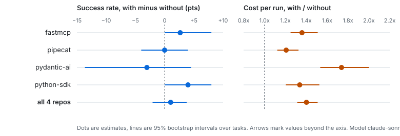

# ctxlift

ctxlift tells you what your `AGENTS.md` or `CLAUDE.md` costs per coding-agent run, and whether it changes how often the agent solves real tasks from your repo.

It replays your repo's merged pull requests as tasks with hidden tests, runs Claude Code on each one with and without your context files, and compares the two with paired statistics.

<!-- headline:start -->

Across 97 tasks from 4 repos (582 runs, Claude Code with claude-sonnet-5-5), the context files did not measurably change how often tasks were solved (+1.0 points, 95% CI -2.1 to +3.8, p = 0.67), and each run cost 1.40x as much with them (95% CI 1.31x to 1.51x).

<!-- headline:end -->



## Results

We ran it on four Python repos that keep a substantial context file. Each repo gave 22 to 25 tasks from recent merged PRs, and every task ran 3 times with the files and 3 times without.

<!-- results:start -->

Claude Code 2.1.328 with claude-sonnet-5-5, 3 runs per task and arm, capped at $2 and 30 minutes per run, in a Docker sandbox whose network reaches only the model API.

| repo | tasks | solved without | solved with | difference | p | cost per run, with ÷ without |
|---|---|---|---|---|---|---|
| [PrefectHQ/fastmcp](https://github.com/PrefectHQ/fastmcp) | 25 | 68.0% | 70.7% | +2.7 pts | 1.00 | 1.36x (1.25x to 1.51x) |
| [pipecat-ai/pipecat](https://github.com/pipecat-ai/pipecat) | 25 | 48.0% | 48.0% | +0.0 pts | 1.00 | 1.21x (1.12x to 1.33x) |
| [pydantic/pydantic-ai](https://github.com/pydantic/pydantic-ai) | 22 | 75.8% | 72.7% | -3.0 pts | 1.00 | 1.74x (1.53x to 2.00x) |
| [modelcontextprotocol/python-sdk](https://github.com/modelcontextprotocol/python-sdk) | 25 | 72.0% | 76.0% | +4.0 pts | 0.25 | 1.34x (1.20x to 1.53x) |
| **all 4 repos** | 97 | 65.6% | 66.7% | +1.0 pts | 0.67 | 1.40x (1.31x to 1.51x) |

Merge dates, per-repo reports, cost caveats and the raw records are in [bench/RESULTS.md](bench/RESULTS.md).

<!-- results:end -->

How to read this:

- The cost increase is clear in every repo. The success difference is not: no repo's permutation test comes near significance (p from 0.25 to 1.00), and the pooled interval runs from -2.1 to +3.8 points.
- With about 25 tasks, one repo can only rule out large effects on success. Small effects of a few points would need several times more tasks.
- This is one model, one Claude Code version and four repos. Your repo can behave differently, so run it on yours.

Two infrastructure bugs were found and fixed before publishing, and 50 affected runs were run again. The details are in [docs/methodology.md](docs/methodology.md#corrections-to-the-published-data).

## Why

Model providers recommend context files, and many repos now have one. Studies that average over many repos find little effect on success and a clear increase in cost, but an average can't tell you whether your file helps your repo. ctxlift runs the comparison on your repo's own history.

## How it works

1. `mine` picks small merged PRs that change both code and tests.
2. `validate` keeps a task only if the PR's tests fail before the change and pass after it, three times in a row.
3. `run` gives the agent the code as it was before the PR, with or without the context files, and the PR's title and description as the prompt. The tests stay hidden.
4. Grading copies the agent's changes into a clean checkout, adds the PR's tests and runs them.
5. `report` compares the two arms task by task: a bootstrap interval, a paired permutation test, the smallest difference the data could detect, and the cost ratio.

By default `validate` and `run` execute in Docker. The agent's container sees only its workspace, has no credentials, and can reach nothing but a relay for the model API, so it can't look up the merged solution. Arms, grading rules and the sandbox are described in [docs/methodology.md](docs/methodology.md).

## Install

You need Node.js 24, `git`, `gh` (logged in), Docker 28 or later, and a Claude token. Until the first npm release, install from a clone:

```sh
git clone https://github.com/SametDemirtas/ctxlift && cd ctxlift
npm install && npm run build && npm link

claude setup-token                                      # copy the token it prints
pbpaste > ~/.ctxlift-token && chmod 600 ~/.ctxlift-token
```

On Linux, write the token to `~/.ctxlift-token` any way you like and keep it readable only by you.

ctxlift passes the token only to the relay container. More on tokens, API keys and running without Docker is in [docs/running.md](docs/running.md).

## Quickstart

```sh
git clone https://github.com/OWNER/REPO /path/to/clone

ctxlift mine OWNER/REPO --since 2026-07-01 --max 60
ctxlift validate tasks/OWNER__REPO.json --clone /path/to/clone
ctxlift run tasks/OWNER__REPO.valid.json --clone /path/to/clone --arms repo,none --reps 3
ctxlift report results/runs.jsonl --baseline none --treatment repo
```

Try `run` with `--limit 3 --reps 1` first to see the cost. The first run builds the sandbox image, which takes a few minutes. `validate` and `run` resume where they stopped, and `--workers N` runs several agents at once. See [docs/running.md](docs/running.md).

## What to expect on your repo

With about 25 tasks you will usually get a clear cost ratio and a success difference whose interval spans zero. That rules out a large effect on success at that confidence and leaves a small effect of a few points possible. Detecting a few points takes many more tasks, and the cost grows with the task count. Each of the four repos above cost about $18 to $25 in recorded spend at 3 runs per task and arm, $89 in total, and 8 timed-out runs report no cost, so the true figures are somewhat higher.

Tests measure task success only. Rules about style, naming or files to leave alone don't show up in the success rate.

## Limitations

- Python projects tested with pytest through `uv`, and Claude Code as the agent. Other runners and agents need an adapter (see [CONTRIBUTING.md](CONTRIBUTING.md)).
- Tasks come from PRs that ship tests. PRs that add a new API are mostly filtered out, so the task set leans toward bug fixes and changes to existing behaviour.
- Grading runs only the PR's own tests, so regressions elsewhere in the suite are missed.
- PRs merged before the model's training cutoff may be in its training data. Use `--since` with a later date when you can.
- Results hold for one repo, one model and one agent version. The full list of limitations is in [docs/methodology.md](docs/methodology.md#limitations).
- An agent that deliberately tampers with the test process could fake a pass. ctxlift catches a report that contradicts the exit code, but it is not proof against that. [SECURITY.md](SECURITY.md) lists what the sandbox does not cover.

## Related work

- [Gloaguen et al., "Evaluating AGENTS.md"](https://arxiv.org/abs/2602.11988) (ETH Zürich, 2026): across agents and models, context files did not generally improve task success and raised inference cost by over 20%. ctxlift uses the same with-and-without design on one repo you pick.
- [context-files-coding-agents](https://github.com/codeprakhar25/context-files-coding-agents) (REALM @ EMNLP 2026): Claude Code and Codex CLI on merged PRs from three Python repos, with no measurable change in correctness.
- [agents-md-evals](https://github.com/vltansky/agents-md-evals): checks which rules in a context file change the agent's behaviour. It measures whether instructions are followed; ctxlift measures whether tasks get solved.
- [McMillan, "Instruction Adherence in Coding Agent Configuration Files"](https://arxiv.org/abs/2605.10039): size, structure and position of instructions had no detectable effect on compliance over 1,650 Claude Code sessions.

## License

MIT
